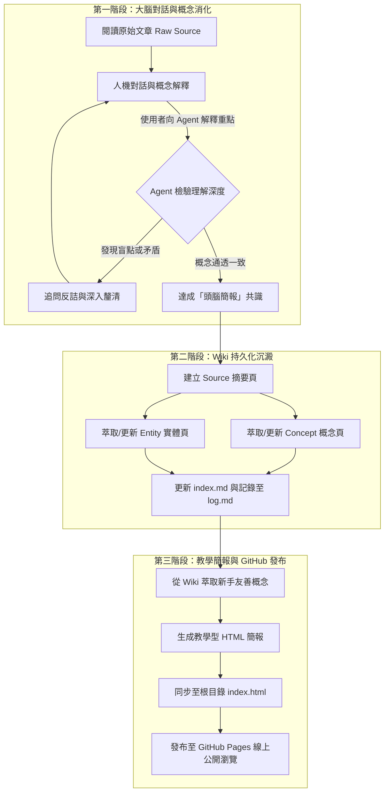

# AGENTS.md — LLM Wiki 操作規範（大腦簡報與人機對話共創版）

> **核心哲學（Core Philosophy）**：
> 我做 LLM Wiki 的核心目的，是**「從文章內容中提煉出能跟我頭腦做簡報的結構，並透過跟 Agent 互相解釋概念、深入討論，徹底搞懂內容」**。
> Wiki 不是被動的資料堆疊，而是我大腦思考的外顯化與延伸（External Brain）。最後，這些經過討論、消化的知識與教學簡報，會同步發布到 **GitHub Repository 與 GitHub Pages** 供公開瀏覽。

---

## 一、專案定位與目標

- **主題**：RWA（現實世界資產代幣化）× 台灣金融專法治理與商業分析
- **終極目標**：
  1. **跟大腦做簡報（Mental Rehearsal）**：把生硬複雜的文章條文與財務模型，轉化為自己大腦能直觀吸收、能清楚向他人講述的思維地圖。
  2. **費曼式人機對話（Feynman Dialogic Co-creation）**：透過「使用者解釋想法 ↔ Agent 提問與補充 ↔ 共同梳理邊界」的互動過程，確保真正理解文章本質，再將成果沉澱為 Wiki 頁面。
  3. **GitHub Pages 網頁發布**：將知識庫、結構化索引與互動式教學 HTML 簡報整合，支援 GitHub Pages 一鍵線上部署與分享。

---

## 二、目錄與 GitHub Pages 結構

```text
做報告/
├── index.html                 ← GitHub Pages 根目錄首頁 (直覺展示教學簡報與知識庫入口)
├── AGENTS.md                  ← 本操作規範 (LLM 的互動與維護手冊)
├── 作業繳交報告.md            ← 作業報告 (含 GitHub/Pages 連結、流程圖與反思)
├── raw/                       ← 原始來源文件 (PDF / PPTX / DOCX，唯讀真相層)
└── wiki/                      ← LLM 維護的結構化知識庫
    ├── index.md               ← 知識庫全域目錄索引
    ├── log.md                 ← 討論與操作時序日誌 (Append-only)
    ├── sources/               ← 來源摘要與關鍵段落
    ├── concepts/              ← 概念辨析與討論淬鍊頁
    ├── entities/              ← 核心實體、法規條文與機構
    └── slides/                ← 產出之教學型 HTML 簡報
```

---

## 三、互動流程設計（Loop / Graph）

Agent 在處理本專案時，必須遵循以下三大核心迴圈：



### 1. 「跟頭腦做簡報」的 Ingest 流程
- **不直接偷懶摘要**：Agent 閱讀原始資料後，先梳理出「如果要在 3 分鐘內向一個外行解釋這篇文章，核心邏輯是什麼？」。
- **概念解釋與辯論**：
  - 聚焦於文章中模糊、抽象的關鍵詞（例如：「RWA 何時會被台灣金管會認定為有價證券？」、「DCF 與 DDM 在星宇航空案例中為何有價差？」）。
  - 使用者解釋其理解，Agent 指出是否有邏輯盲點，並補充文章中的支撐數據。
- **沉澱與交織**：雙方確認理解無誤後，Agent 才把討論精華寫入 `wiki/concepts/`，並以 `[[wikilinks]]` 進行雙向鏈接。

### 2. 「教學 HTML 簡報」生成流程
- **面向零基礎聽眾**：簡報必須能讓完全不熟悉該領域的人快速理解。
- **雙向引用驗證**：每一張投影片的論據必須有 Wiki 頁面對應，杜絕幻覺。
- **單檔全功能設計**：採用原生 HTML5/CSS3/JavaScript，自帶翻頁邏輯與進度條，相容於 GitHub Pages。

---

## 四、頁面格式規範

### 4.1 Concept 概念頁（聚焦討論與邊界釐清）
```markdown
---
type: concept
title: "概念名稱"
tags: [領域標籤]
source_count: N
last_updated: YYYY-MM-DD
---

## 大腦簡報一句話（Core Intuition）
> 用最白話的一句話，讓大腦瞬間記住這個概念。

## 概念深入與定義
（清楚拆解本質、應用場景）

## 人機討論重點與邊界辯析
- **常見迷思**：...
- **辨析與對照**：...

## 相關連結
- 來源：[[sources/...]]
- 實體：[[entities/...]]
- 相關概念：[[concepts/...]]
```

---

## 五、GitHub Pages 發布規範

1. **根目錄首頁保證**：專案根目錄必須維持一份可直接執行的 `index.html`，讓開啟 GitHub Pages 時預設載入教學簡報與知識庫導覽。
2. **純相對路徑**：所有資源、CSS、內部鏈接必須使用純相對路徑（Relative Paths），避免在 GitHub Pages 子路徑（`https://username.github.io/repo-name/`）下失效。
3. **輕量無依賴**：不需要繁雜的 build step（無需 Node.js/npm 編譯），推送（git push）即可秒級上線。

---

*Schema 版本：v2.0（大腦簡報與人機對話共創版） | 維護者：Agent & User 共同演化*
