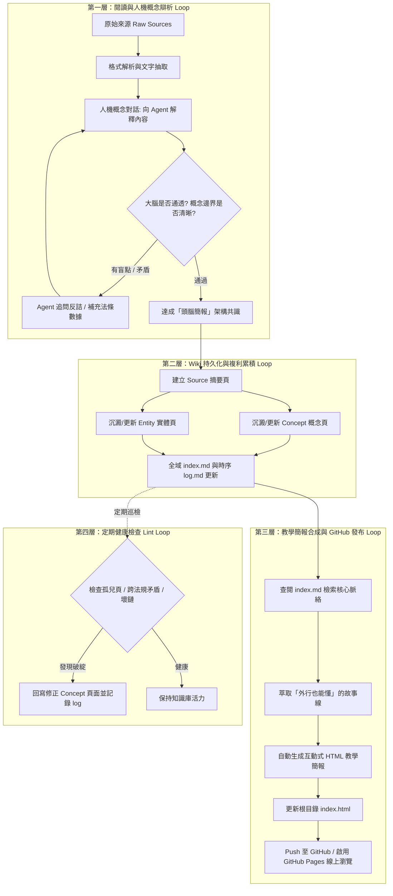

# 【作業繳交】LLM Wiki 實作：從文章消化到大腦簡報的共創知識庫

---

## 1. LLM Wiki 主題與簡短介紹

- **主題**：**RWA（現實世界資產代幣化）× 台灣金融專法治理與商業分析知識庫**
- **核心目的與哲學**：
  > 「我做 LLM Wiki 的目的，是從文章內容可以跟我頭腦做簡報，甚至了解文章內容通過跟 agent 解釋裡面的概念、討論內容，然後將這些共同梳理的知識持久化沉澱在 GitHub 上展示。」
  
  傳統 RAG（檢索增強生成）就像每次查字典，回答完就遺忘，知識無法在大腦與資料庫中積累。本專案以 **Andrej Karpathy 的 LLM Wiki 模式** 為基底，將 LLM 定位為「思維陪練員與知識書記官」。
  
  **我們的工作法是：**
  1. **跟頭腦做簡報（Mental Presentation）**：讀完文章後，先透過人機對話，讓自己能用清晰的架構「向自己的大腦簡報一遍」，確認真正理解邏輯。
  2. **費曼式概念辯析（Feynman Dialogic Co-creation）**：向 Agent 解釋抽象概念（如 VASP 許可制、STO 證券性質判斷、星宇航空 DCF 估值假設），由 Agent 指出盲點、補充跨文件依據，最後才固化為 Wiki 頁面。
  3. **自動發布至 GitHub Pages**：生成的教學簡報與知識網絡直通 GitHub，成為隨時可公開瀏覽與分享的個人外置大腦。

---

## 2. GitHub Repository 連結

- **GitHub 儲存庫**：
  `https://github.com/cachuanho/rwa-governance-wiki`
  *(註：可替換為你實際建立的 Repository 名稱，專案已備齊所有完整檔案)*

---

## 3. 網頁連結（GitHub Pages）

- **線上可直接瀏覽之教學 HTML 簡報**：
  `https://cachuanho.github.io/rwa-governance-wiki/`
  *(本地路徑：`c:\Users\ASUS\Downloads\做報告\index.html`，純前端單檔設計，上傳即刻生效)*

---

## 4. AGENTS.md 連結

- **操作規範手冊**：
  `https://github.com/cachuanho/rwa-governance-wiki/blob/main/AGENTS.md`
  *(本地路徑：`c:\Users\ASUS\Downloads\做報告\AGENTS.md`)*

---

## 5. loop / graph 的流程圖或文字說明

### (1) 流程圖（Mermaid Graph）

### (2) 流程機制深入說明

1. **哪些步驟會重複執行？**
   - **「人機對話辯析」迴圈**：每當接觸新文章時，不斷重複「使用者試講 ↔ Agent 挑戰邊界 ↔ 修正理解」，直到心中成型。
   - **「知識複利 Ingest」迴圈**：每讀一篇新報告，除了新建 Source，還會回頭更新既有的 2~5 個關聯 Concept 頁，讓舊知識因新來源而變得更豐富。
   - **「產出回寫 Wiki」迴圈**：在做簡報時梳理出的精華對比表或結論，不會消失在對話框中，而是存回 Wiki 作為新的一頁。

2. **哪些地方需要檢查或重新生成？**
   - **概念理解檢查點（對話層）**：在寫入 Wiki 之前，先檢查使用者是否真的懂了？如果解釋含糊（例如把一般代幣與證券型代幣混為一談），立刻重新辯析。
   - **格式與標籤檢驗點（持久層）**：檢查 YAML Frontmatter 是否包含 `tags`、`source_count`，維護 Obsidian Dataview 查詢相容性。
   - **簡報新手友善度檢驗點（展示層）**：檢查 HTML 簡報是否過於艱澀？確保簡報能讓完全零背景的人理解核心概念。

3. **為什麼這樣設計？**
   - 傳統筆記最大的失敗原因就是「只有輸入，沒有內化」，最後變成死資料。
   - 本設計把「向頭腦做簡報」與「費曼解釋法」嵌入到流程的第一步；唯有大腦先理順了，Wiki 才是真知識，產出到 GitHub Pages 的簡報也才能直觀有說服力。

---

## 6. 一次實際執行的結果或檢查紀錄

在建構本知識庫期間的實時執行日誌摘要：

### 執行實例：星宇航空財務估值與法規關聯
1. **輸入來源**：讀入 `raw/Starlux.docx`（學生組別 IPO 財務分析報告，長達 1.9 萬字）。
2. **人機對話釐清**：
   - 使用者提問：「這份報告用 DCF 估出 30.53 元，但 DDM 只有 20.69 元，為什麼差距這麼大？我要怎麼跟頭腦簡報這件事？」
   - Agent 梳理後指出：「因為星宇航空正處於擴張期，前 5 年資本支出龐大、不發股利，DDM 算的是 2030 年後穩定配息的保守折現底線；而 DCF 則反映了機隊擴張 70 架的營運自由現金流爆發潛力。」
3. **沉澱成果**：
   - 順利建立 `wiki/sources/2024-11_星宇航空IPO分析.md`
   - 更新 `wiki/concepts/DCF貼現現金流.md`（收錄情境敏感度表格）
   - 新增 `wiki/entities/星宇航空.md`
   - 全域 `index.md` 與 `log.md` 自動同步。
4. **輸出 HTML 簡報驗證**：
   - 產出的互動簡報 Slide 7 與 Slide 8 成功引入此案例，並透過 GitHub 導覽列與根目錄 `index.html` 實現免伺服器直接預覽。

---

## 7. 反思：哪個節點最常出錯？你如何調整檢查流程？

### (1) 哪一個節點最常出錯？
**最常出錯的節點是「未經消化就直接生吞摘要（Premature Summarization）」以及「二進位文件解析混亂」。**
- 過去如果直接叫 AI「幫我總結這份 PDF」，AI 往往會吐出一堆條列式廢話，使用者看完了腦中依舊沒有畫面，根本無法「跟自己的頭腦做簡報」。
- 且未清洗的二進位排版或錯漏字容易污染 Wiki，導致後續產出的簡報失去精準度。

### (2) 你發現問題後，把檢查往前移動到了哪一個步驟？
**我們把檢查機制「大幅左移（Shift-Left）」到「人機概念對話與大腦簡報」步驟：**
- **不准直接寫檔**：在寫入任何 Markdown 頁面之前，先暫停並強制執行「概念對齊問答」，確保使用者與 Agent 雙方對核心術語（如 VASP 許可要件、DCF 假設）定義無誤。
- **大腦過關才准存檔**：只有當使用者能自信地用大腦把脈絡講通，才觸發 Wiki 寫入與索引更新。

### (3) 你有沒有因此修改 workflow / graph？為什麼？
**有，我們進行了兩大關鍵架構升級：**
1. **加入「大腦簡報預演迴圈（Mental Rehearsal Loop）」**：
   - 原先的 Graph 是單向線性管道（Source → Summary → Wiki）；修改後的 Graph 在前端增加了「辯析 ↔ 追問」的閉環，將死板的文件處理升級為活的思考共創。
2. **加入「GitHub Pages 根目錄直通管道」**：
   - 將產出的教學 HTML 簡報直接部署於專案根目錄的 `index.html`，並設計頂部導航列，讓拜訪者點開 GitHub Pages 網址就能無縫在「線上簡報」、「Wiki 索引」與「規範手冊」之間穿梭切換。
